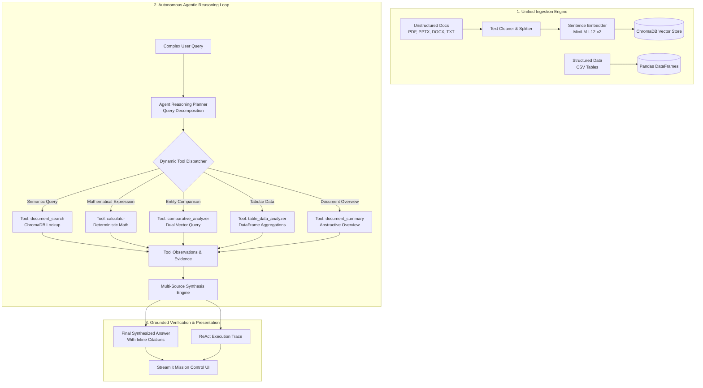

# Agentic Retrieval-Augmented Generation (Agentic RAG) System 🤖🛠️

[](https://www.python.org/)
[](https://streamlit.io/)
[](https://www.trychroma.com/)
[](https://huggingface.co/sentence-transformers/paraphrase-multilingual-MiniLM-L12-v2)
[](#system-architecture)
[](#license)

An end-to-end autonomous **Agentic RAG** system designed to resolve complex, multi-hop, and analytical user questions. While conventional RAG adheres to a rigid, single-step lookup pipeline, **Agentic RAG** introduces an intelligent reasoning agent that formulates execution plans, dynamically selects and invokes specialized tools, and synthesizes answers from both unstructured documents and structured tabular datasets.

---

## 🌟 Key Features

- **Autonomous Query Planning:** Decomposes multi-faceted questions into structured sub-tasks before initiating retrieval.
- **Integrated Tool Registry:**
  - 🔍 **`document_search`**: Semantic vector search across PDF, PPTX, DOCX, and TXT files using ChromaDB.
  - 🧮 **`calculator`**: Deterministic mathematical engine preventing LLM arithmetic hallucination during percentage, ratio, and speedup calculations.
  - 📄 **`document_summary`**: High-level abstractive summarization across document sections.
  - ⚖️ **`comparative_analyzer`**: Dual-retrieval pipeline structuring side-by-side comparative matrices between technical entities.
  - 📊 **`table_data_analyzer`**: Programmatic pandas DataFrame querying for structured numerical data (such as cloud instance pricing and hardware specs).
- **Multi-Format Ingestion with OCR:** Native parsers for PDF (with automated RapidOCR fallback for scanned slides), PowerPoint, Word, CSV, and plain text.
- **Dual Inference Mode:** Instantaneous local semantic reasoning or cloud-accelerated inference via **Google Gemini API**.
- **Interactive Streamlit Mission Control:** Visualizes the agent's internal reasoning loop, planned roadmap, individual tool calls, and grounded source citations.
- **Research Notebook & Benchmark Suite:** Complete evaluation notebook (`agentic_rag_evaluation.ipynb`) and curated test dataset (`evaluation_cases.csv`).

---

## 🏗️ System Architecture



---

## 🆚 Standard RAG vs. Agentic RAG

| Capability | Standard / Naive RAG | Corrective RAG | **Agentic RAG (This System)** |
| :--- | :--- | :--- | :--- |
| **Pipeline Nature** | Fixed single-step pipeline | Self-evaluating loop | **Autonomous multi-step agent** |
| **Tool Usage** | ❌ Retrieval only | ❌ Retrieval + Rewriter | **✅ Full Tool Registry (Search, Math, Tables, Comparison)** |
| **Multi-Hop Questions**| ❌ Often fails / incomplete | ⚠️ Partial | **✅ Decomposes into sequential tool steps** |
| **Arithmetic / Math** | ❌ Hallucinates calculations | ❌ Hallucinates calculations | **✅ Exact deterministic computation via Calculator** |
| **Tabular Data** | ❌ Unreliable string parsing | ❌ Unreliable string parsing | **✅ Native Pandas DataFrame analytical tool** |

---

## 📁 Repository Structure

```text
Agentic_RAG_System/
│
├── app.py                          # Streamlit interactive agent dashboard & ReAct visualizer
├── agentic_engine.py               # Core Agent engine (Ingestor, Tools, Planner, Synthesizer)
├── agentic_rag_evaluation.ipynb    # Evaluation Jupyter Notebook for multi-tool benchmarks
├── evaluation_cases.csv            # Test dataset categorized by query complexity
├── requirements.txt                # Production Python dependencies
├── .gitignore                      # Git exclusion rules for virtualenvs, cache, and DB
│
├── .streamlit/
│   └── config.toml                 # Streamlit UI theme configuration
│
└── sample_docs/                    # Multimodal reference documents & datasets
    ├── cloud_providers_pricing_and_performance.csv
    ├── enterprise_rag_and_agentic_systems.txt
    └── gpu_architecture_and_ai_accelerators.txt
```

---

## ⚙️ Technology Stack

| Component | Technology | Description |
| :--- | :--- | :--- |
| **User Interface** | [Streamlit](https://streamlit.io/) | Full interactive dashboard with tool execution telemetry |
| **Vector Database** | [ChromaDB](https://www.trychroma.com/) | Persistent HNSW index with cosine similarity metric |
| **Embeddings** | `sentence-transformers` | `paraphrase-multilingual-MiniLM-L12-v2` |
| **Data Analytics** | `pandas` | Structured tabular querying and numerical aggregation |
| **Parsers & OCR** | `pypdf`, `pypdfium2`, `RapidOCR` | Native extraction with fallback for scanned documents |
| **LLM Inference** | Gemini API / Local Synthesis | Dual-engine support for online reasoning and offline execution |

---

## 🚀 Getting Started

### Prerequisites
- **Python 3.11** recommended
- Windows / Linux / macOS

---

### Installation & Setup

1. **Navigate to the project folder:**
   ```bash
   cd Agentic_RAG_System
   ```

2. **Create and activate a virtual environment:**
   * **Windows (PowerShell):**
     ```powershell
     py -3.11 -m venv .venv
     .\.venv\Scripts\Activate.ps1
     ```
   * **Linux / macOS:**
     ```bash
     python3.11 -m venv .venv
     source .venv/bin/activate
     ```

3. **Install dependencies:**
   ```bash
   python -m pip install --upgrade pip
   pip install -r requirements.txt
   ```

---

### Running the Application

1. **Start the Streamlit Server:**
   ```bash
   streamlit run app.py
   ```
2. **Access the application:** Open `http://localhost:8501` in your browser.
3. **Populate Knowledge Base:**
   - Click **"Load Samples"** in the sidebar to ingest the bundled academic papers and cloud pricing dataset.
4. **Interact with the Agent:**
   - Select one of the quick prompts (e.g. *Cloud Table*, *H100 vs A100*, or *Compute Speedup*).
   - Inspect the **Agent's Decomposed Plan**, the **ReAct Scratchpad** showing tool calls and observations, and the final synthesized response with citations.

---

## 📊 Benchmark Evaluation

Open `agentic_rag_evaluation.ipynb` to execute the full evaluation suite:
```bash
jupyter notebook agentic_rag_evaluation.ipynb
```

The notebook benchmarks the agent's ability to dispatch appropriate tools across single-hop queries, comparative analysis, numerical tables, and deterministic arithmetic.

---

## 🛡️ License

Developed for educational and academic research purposes.
